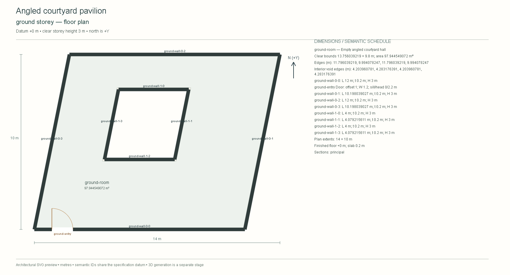
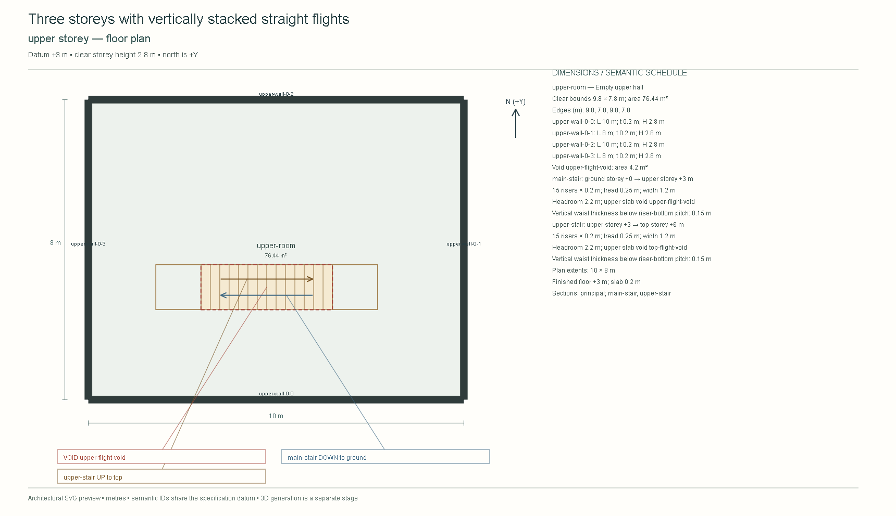
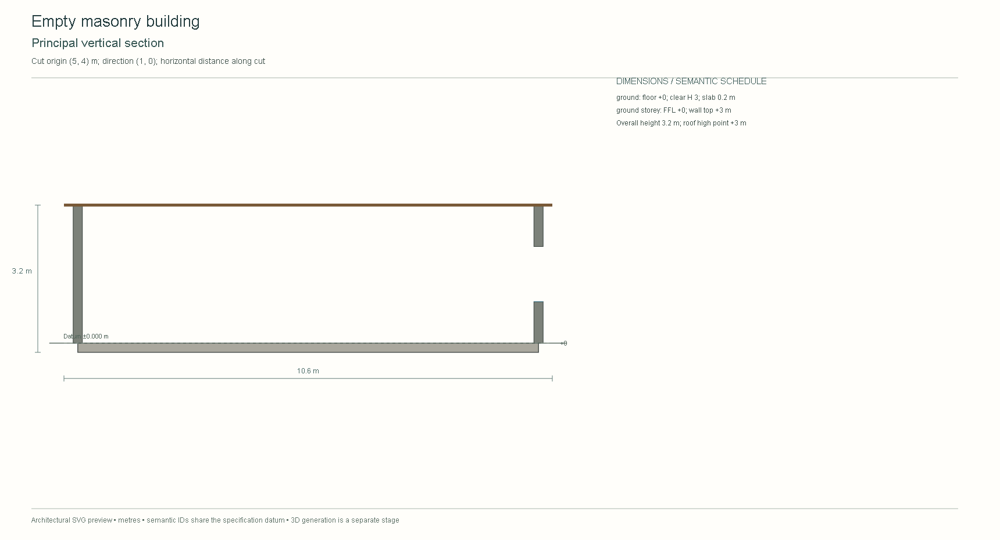
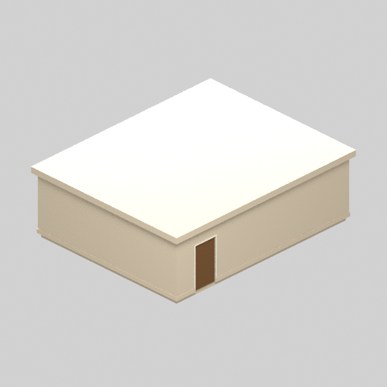
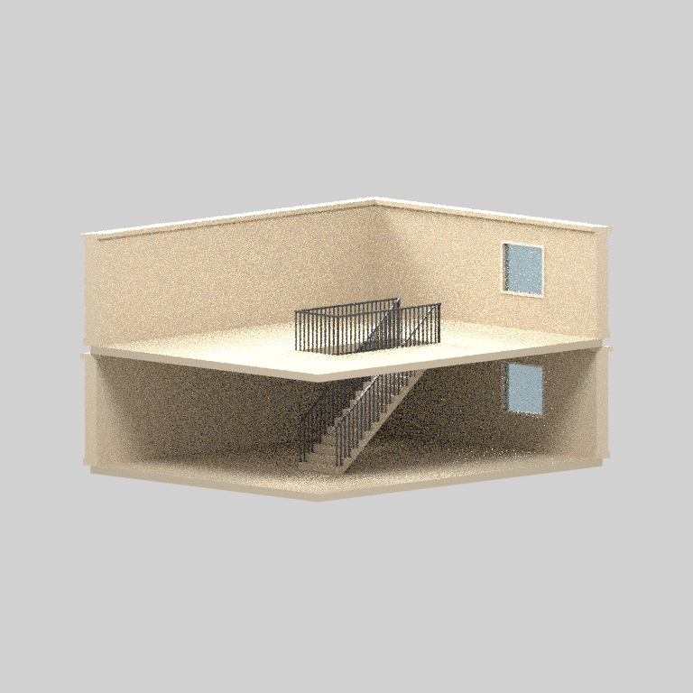
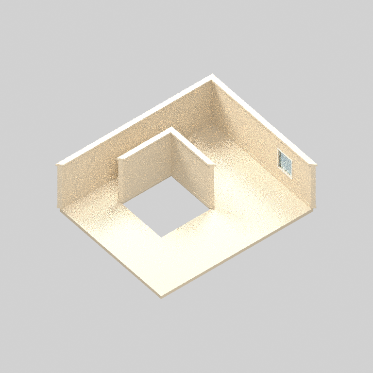

# Architectural QA examples

These drawings come from the actual floor-plan CLI fixtures. They show the design foundation's empty-room architecture; they are technical QA examples, with no human building approval, 3D model or runtime acceptance implied.

The [contract guide](../../resources/floor-plan-to-model/README.md) defines dimensions, geometry and whole-package review. The [CLI fixtures](../../tests/test-floor-plan-cli.py) generate the windowed variant and verify all floor, roof, elevation and section sheets. These three images are examples from the complete independently reviewed drawing packages.

## Angled courtyard floor

## Stacked stair flights

## Window section

## Actual Blender construction

These owned procedural v2 examples were built twice in Blender 4.5.10 LTS, then independently loaded for source inspection and CPU review renders. Measured mesh geometry, floor identities, material assignments and separate visual/collision objects are verified against the approved engineering fixture inputs. The fixture review assertions are synthetic; they grant no human architectural or model acceptance.

The fixed review bundle uses eight Cycles samples for bounded diagnostic renders. Bright surfaces and visible sampling noise limit appearance judgments. GLB export/re-import and game-engine collision or movement evidence are separate stages.

